  <!-- ==================== HERO SECTION ==================== -->
  

   

  <!-- ==================== SKILLS SECTION ==================== -->
  

   

  <!-- ==================== CONTRIBUTION DASHBOARD ==================== -->
  

   

  <!-- ==================== CONTRIBUTION HEATMAP ==================== -->
  

   

  <!-- ==================== FEATURED PROJECTS ==================== -->
  

    
    
  

  

    
    
  

   

  <!-- ==================== CONNECT SECTION ==================== -->
  

---

### 📂 Featured Architectural Showcase

| Project | Category | Primary Stack | Repository / Live |
| :--- | :--- | :--- | :--- |
| **Aura** | Full-Stack Audio Streaming | React, TypeScript, Node.js, Express, MySQL, WebGL | [Live Demo ↗](https://music-six-lemon.vercel.app/) • [Repository →](https://github.com/Abbusufiyan/Music) |
| **NexusEMS** | Intern Management Platform | React.js, Node.js, Express.js, MySQL, JWT | [Repository →](https://github.com/Abbusufiyan/Employee_Management_System) |
| **3D Portfolio** | Interactive Web Experience | React, TypeScript, Three.js, R3F, Tailwind | [Live Demo ↗](https://portfolio-website-ten-theta-96.vercel.app/) • [Repository →](https://github.com/Abbusufiyan/Portfolio-Website) |
| **Acer ALG Control** | Linux Hardware Utility &amp; GUI | Python 3, PyQt6, ACPI Driver, DKMS, Linux Sysfs | [Repository →](https://github.com/Abbusufiyan/ACER-ALG-KEYBOARD-LIGHT-CONTRO) |

---

### 🌐 Direct Channels &amp; Profiles

- **Interactive Portfolio:** [portfolio-website-ten-theta-96.vercel.app](https://portfolio-website-ten-theta-96.vercel.app/)
- **LinkedIn:** [linkedin.com/in/abu-sufiyan-5b1934333](https://linkedin.com/in/abu-sufiyan-5b1934333/)
- **GitHub:** [github.com/Abbusufiyan](https://github.com/Abbusufiyan)
- **LeetCode:** [leetcode.com/u/BUHw5Vatuj](https://leetcode.com/u/BUHw5Vatuj/)

---

  ⚡ Automated telemetry refreshed daily via GitHub Actions • Engineered with pure SVG &amp; CSS keyframe animations

