<!-- Every card is an animated SVG drawn by scripts/render_readme_cards.py and refreshed daily
     by .github/workflows/update-profile-art.yml. Design: "Three Worlds", paper, ink and blue palette.
     Spacing is baked into the SVGs, so keep this block free of blank lines and keep the cards in
     a row on one line with no spaces between them. -->

 
 
 
 
<picture><source media="(prefers-color-scheme: dark)" srcset="./cards/title-coding-dark.svg" /></picture> 
 

<a href="https://portfolio-website-ten-theta-96.vercel.app/">portfolio</a> &nbsp;/&nbsp; <a href="https://linkedin.com/in/abu-sufiyan-5b1934333/">linkedin</a> &nbsp;/&nbsp; <a href="https://github.com/Abbusufiyan">github</a> &nbsp;/&nbsp; <a href="https://leetcode.com/u/BUHw5Vatuj/">leetcode</a>

